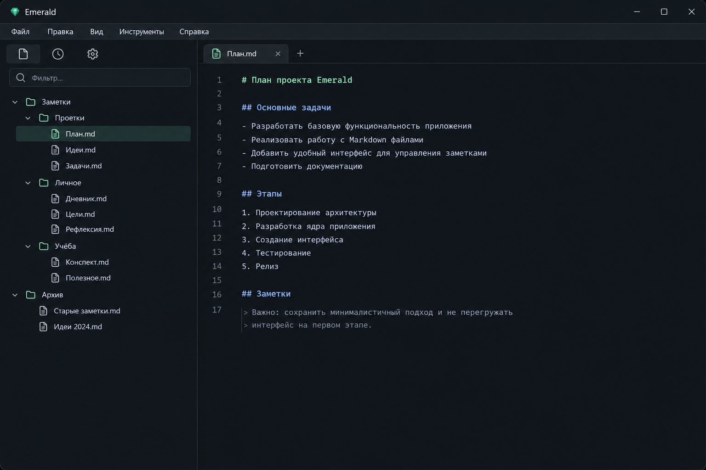

# Emerald

Emerald is a minimalist yet functional Markdown editor built with C++ and Qt.

## Goals

- A minimalist, user-friendly interface
- Maximum performance with minimal latency, supported by C++ and Qt
- The ability to synchronize notes across devices

## Preview

## Technologies

- C++20
- Qt 6.11.2

## Authors

Ras1L

## License

MIT
